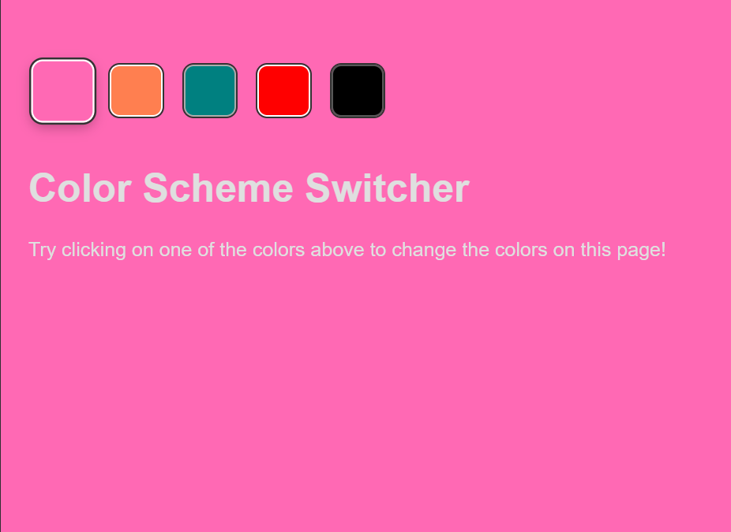
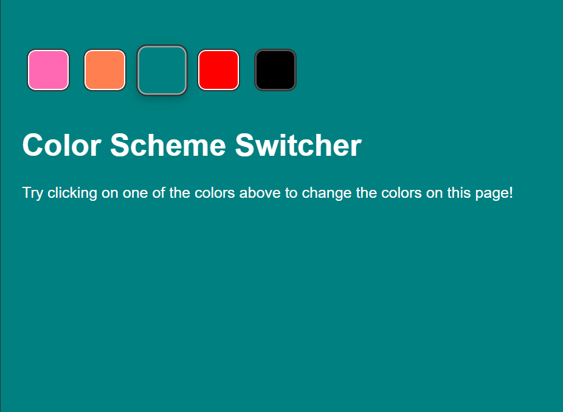

# 🎨 Color Scheme Switcher

A simple and interactive web application built using **HTML, CSS, and JavaScript** that allows users to change the webpage's background and text colors with a single click.

The project features five different color themes, along with smooth hover effects and visual feedback for the selected color.

## ✨ Features

- **Five Color Themes:** Switch between Pink, Coral, Teal, Red, and Black.
- **One-Click Theme Switching:** Change the webpage's background and text color instantly.
- **Interactive Hover Effects:** Color buttons smoothly scale up when hovered over.
- **Active Button Highlight:** The selected color button remains highlighted.
- **Smooth Transitions:** Background and text colors change with smooth CSS transitions.
- **Lightweight Application:** Built using vanilla HTML, CSS, and JavaScript without any external libraries.

## 🖥️ Preview

### Pink Theme


### Teal Theme


## 🛠️ Technologies Used

- **HTML5** – For webpage structure and content.
- **CSS3** – For styling, transitions, hover effects, and button animations.
- **JavaScript** – For handling click events and dynamically changing color themes.

## 📂 Project Structure

```text
Color-scheme-switcher/
│
├── main.html
├── Readme.md
│
└── preview/
    ├── preview-pink.png
    └── preview-teal.png
```

## 🚀 Getting Started

Follow these steps to run the project locally:

1. Clone the repository:

   ```bash
   git clone https://github.com/shruti18sk/Color-scheme-switcher.git
   ```

2. Navigate to the project directory:

   ```bash
   cd Color-scheme-switcher
   ```

3. Open `main.html` in your web browser.

4. Click on any of the five color buttons to explore different themes.

## 🎯 What I Learned

Through this project, I practised:

- Selecting and manipulating DOM elements using JavaScript.
- Handling click events with `addEventListener()`.
- Dynamically updating CSS properties through JavaScript.
- Using CSS transitions and transform effects.
- Managing active states using JavaScript and CSS classes.

## 👩‍💻 Author

**Shruti Singh Kushwah**

[GitHub Profile](https://github.com/shruti18sk)

---

⭐ If you find this project interesting, feel free to explore the repository!
